# Limit order book and multi-agent market simulation

A limit order book exchange built from scratch in Python with a population of interacting trading agents and the measurements of the book *Trades, Quotes and Prices* (Bouchaud, Bonart, Donier, Gould, Cambridge University Press, 2018) applied to the simulated market.

Two questions drive the study:

* **What does a trading strategy really earn once it pays the spread and moves the price?**
* **Which behaviours of market participants produce the statistical regularities of real markets?**

The answers come from comparing two markets built on the same engine. The **baseline market** is a deliberately simple benchmark: uniform random limit orders. The **market ecology** has zero-intelligence liquidity, a market maker, an informed trader, institutional metaorders and latent liquidity. Six directional strategies trade in both.

## Key findings

1. **Each stylized fact needs its own ingredient:** Zero-intelligence liquidity alone gives a realistic spread (1.8 ticks) and fat tails (excess kurtosis 7.2). Only the splitting of metaorders makes the order signs persistent (C(1) = 0.06, still 0.03 at lag 50). Only with an informed trader and a market maker on top does the response function grow with the lag as in real markets (R(20) is twice R(1)). The baseline market reproduces none of these.
2. **The market maker keeps 13% of the spread he earns:** He earns 1.48 ticks per share against the mid-price gives back 1.05 to adverse selection and 0.23 to inventory and keeps 0.20. His markouts show who is toxic: fills against the informed trader lose 3.2 ticks per share after 400 events while fills against uninformed flow stay profitable.
3. **The optimal spread widens with informed flow:** The market maker's best half-spread is 1 tick without an informed trader and 2 ticks with one. With three times more informed flow he barely breaks even at any spread and loses heavily when quoting tight.
4. **Information enters the price slowly:** After news only the informed trader trades in its direction and the mispricing falls from 16 to 5 ticks over 1 500 events while the market maker is pushed against the news.
5. **Aggressive strategies lose in every market but how much depends on liquidity:** The strategies that sweep several price levels lose with high significance in both markets `Trader_bullish` and `Trader_bearish` lose about 110 basis points of wealth in the ecology. Execution costs are a hundred times smaller in the ecology (1 to 6 basis points against 105 to 662) because the baseline book is extremely illiquid.
6. **The square-root law of impact is a property of liquidity:** With zero-intelligence liquidity the impact of a metaorder is linear in its size and permanent. With latent liquidity whose depth grows with the distance to a slow consensus price impact is linear for small metaorders then follows a square root (exponent 0.44) and is mostly transient.

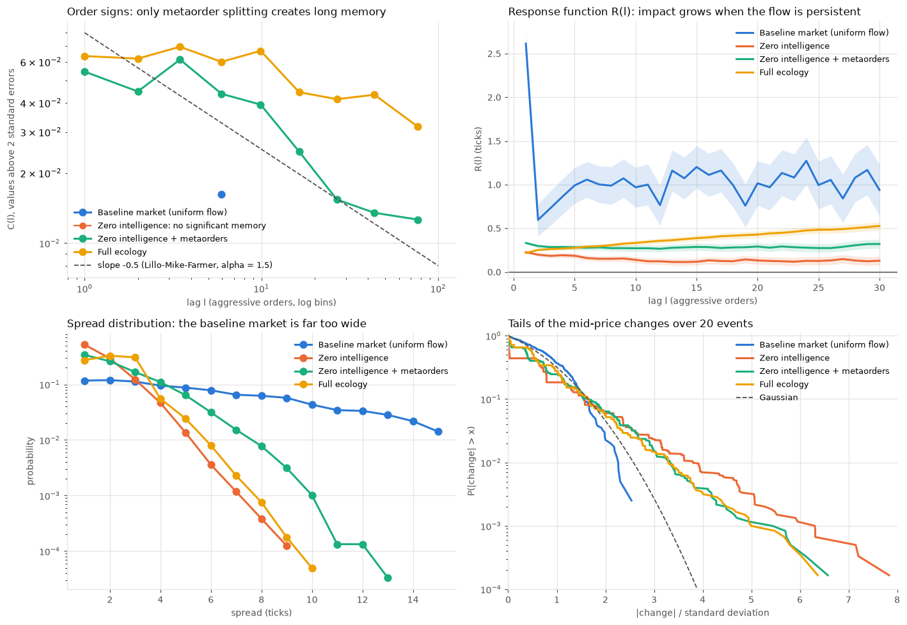

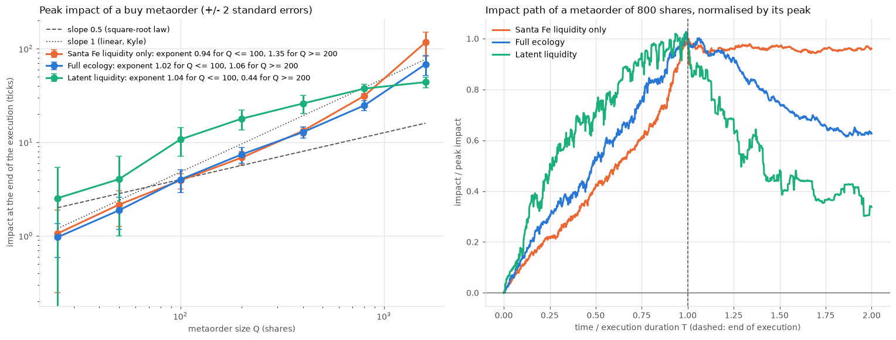

## Who trades with whom, and who earns what

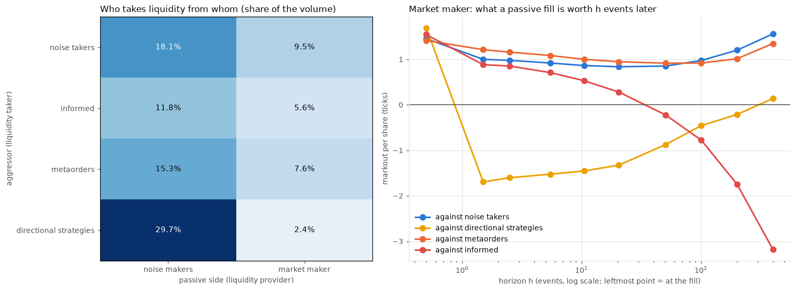

The PnL of every agent is split exactly into the spread earned or paid against the mid-price, the price move in the 100 events after each fill and the holding of the position until the end:

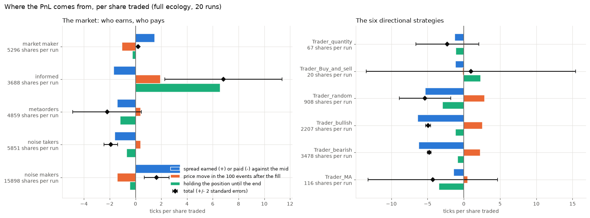

| Agent | Spread (ticks per share) | Adverse selection | Inventory | Total | Shares per run |
|---|---:|---:|---:|---:|---:|
| market maker | 1.48 | -1.05 | -0.23 | 0.20 | 5,296 |
| informed trader | -1.70 | 1.94 | 6.59 | 6.83 | 3,688 |
| metaorders | -1.42 | 0.40 | -1.19 | -2.20 | 4,859 |
| noise takers | -1.62 | 0.41 | -0.69 | -1.90 | 5,851 |
| noise makers | 3.49 | -1.40 | -0.45 | 1.64 | 15,898 |
| `Trader_bullish` | -6.36 | 2.59 | -1.16 | -4.92 | 2,207 |
| `Trader_bearish` | -6.20 | 2.29 | -0.85 | -4.76 | 3,478 |
| `Trader_random` | -5.32 | 2.89 | -2.91 | -5.35 | 908 |

Average over 20 runs of the ecology. The three parts add up to each agent's mark-to-market PnL computed from his own cash and shares.

## Market making and news

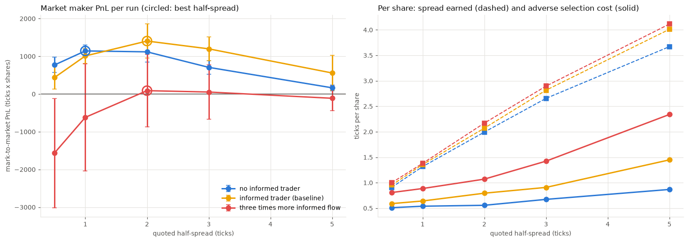

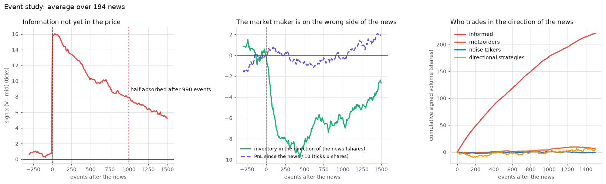

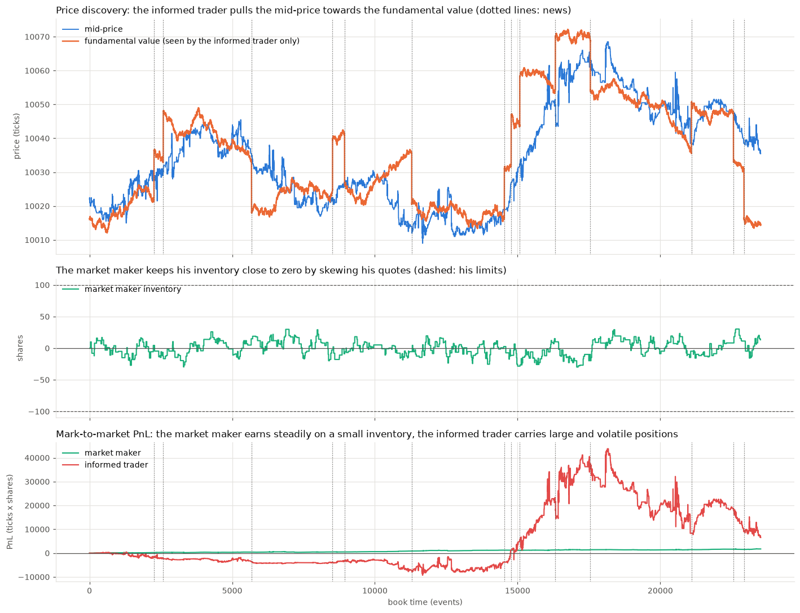

## The six strategies in both markets

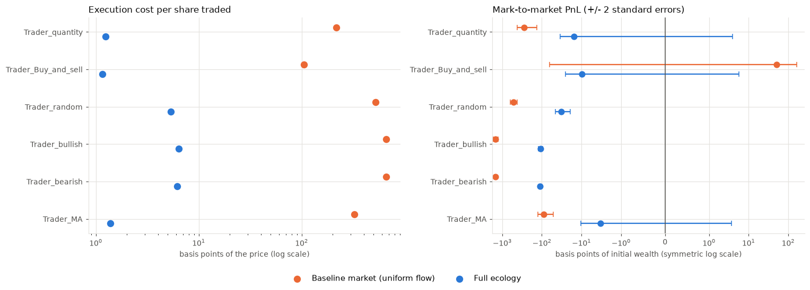

| Strategy | Idea |
|---|---|
| `Trader_quantity` | buys at the best ask when his capital buys fewer shares than the best ask displays sells at the best bid when it is above his purchase price |
| `Trader_Buy_and_sell` | buys the whole best ask queue sells everything once the best bid is above his purchase price |
| `Trader_random` | coin flip: market buy with all his cash or market sell of his shares |
| `Trader_bullish` | market buy with all his cash then limit sell at the worst bid |
| `Trader_bearish` | market sell of his shares then limit buy at the worst ask then limit sell at the worst bid |
| `Trader_MA` | buys when the last trade price is above its moving average sells when it is below |

The baseline market on its own (spread, depth, order flow, impact) and the cost of each strategy in it:

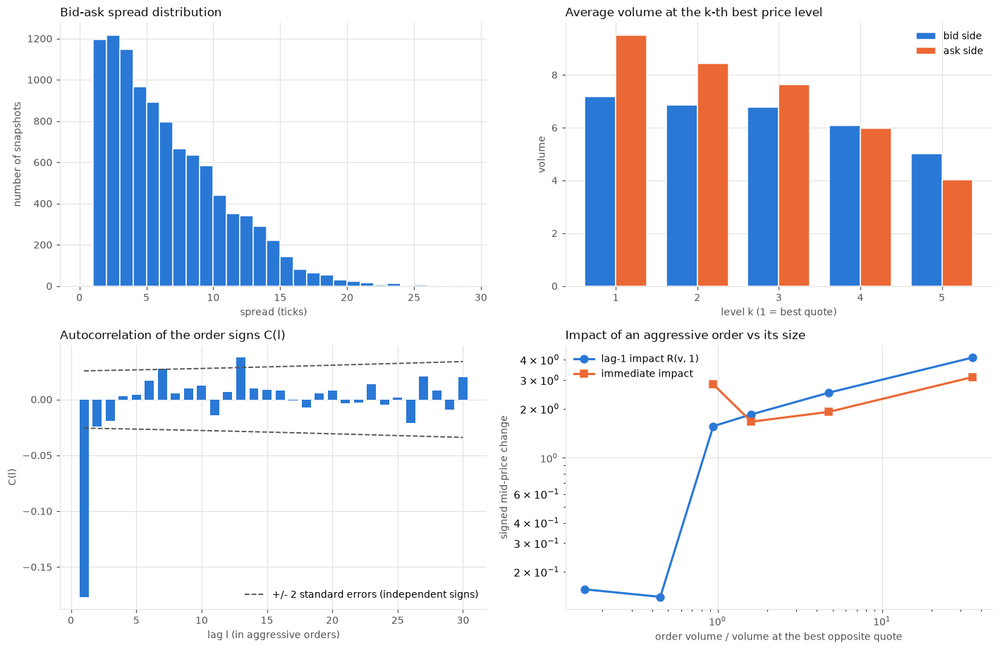

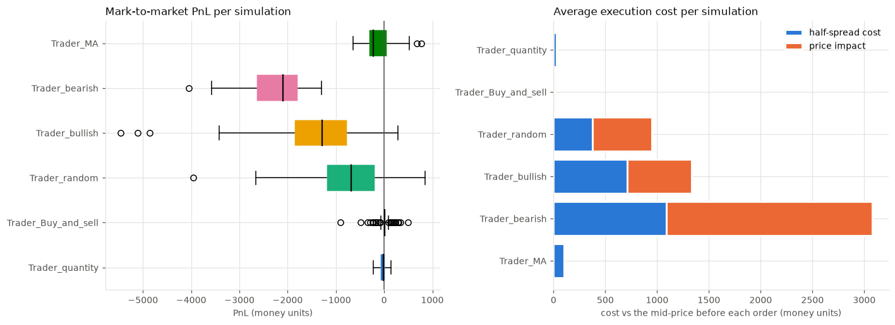

## The market ecology

| Agent | Behaviour | 
|---|---|
| `Trader_noise_maker` | zero-intelligence limit orders 1 to 20 ticks from the opposite best quote cancelled at a constant rate | 
| `Trader_noise_taker` | zero-intelligence market orders | 
| `Trader_market_maker` | quotes around a reservation price skewed by his inventory cancels and requotes | 
| `Trader_informed` | trades towards a fundamental value with news jumps that only he sees | 
| `Trader_metaorder` | Pareto-distributed metaorders split into child market orders | 
| `Trader_latent_liquidity` | orders around a slow consensus price, depth growing linearly with the distance | 
| six directional strategies | see the table above | |

An `Exchange` gives every agent a unique id and tells both counterparties of every trade about their fill so passive liquidity providers have a real PnL. Every event draws the same random numbers whatever happens so the impact of a metaorder is measured by running the market twice with the same seed with and without it (common random numbers). The full model is described in [docs/METHODOLOGY.md](docs/METHODOLOGY.md).

## Measurements

The sign $\varepsilon_t$ of an aggressive order is $+1$ for a buy and $-1$ for a sell, $m_t$ is the mid-price just before the $t$-th aggressive order, and time is counted in aggressive orders.

Autocorrelation of the order signs:

$$
C(\ell)=\langle \varepsilon_t\,\varepsilon_{t+\ell}\rangle-\langle \varepsilon\rangle^{2}
$$

Response function (for $\ell = 1$):

$$
R(\ell)=\langle \varepsilon_t\,(m_{t+\ell}-m_t)\rangle
$$

PnL decomposition of an agent summed over his fills of quantity $q$ at price $p$ with $s = +1$ when he bought $m^{-}$ the mid-price before the fill and $h = 100$ events:

$$
\text{PnL} = \sum_s\,q\,(m^{-}-p) + \sum s\,q\,\big(m(t+h)-m^{-}\big) + \sum s\,q\,\big(m_{end}-m(t+h)\big) + n_0\,(m_{end}-m_{start})
$$

The four terms are the spread earned the adverse selection the inventory and the initial shares $n_0$ held through the run.

Static book experiment: a market order of size $Q$ walking through a static book moves the best price by $I(Q)$ the inverse of the cumulative volume. A flat depth profile gives $I(Q)\propto Q$, a depth growing linearly with the distance gives $I(Q)\propto\sqrt{Q}$.

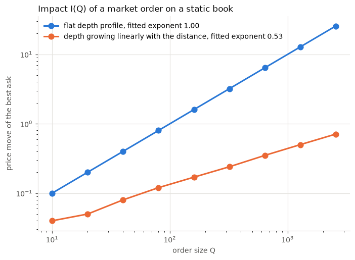

## Repository layout

```
src/
  orderbook.py     matching engine: Order, OrderList, OrderTree, OrderBook
  demo.py          the rules of the exchange on a small book
  agents.py        the six directional strategies, generate_lim_orders, mvt_avg
  analysis.py      measurements: spread, depth, order signs, impact, markouts, flows, PnL decomposition
  simulation.py    the baseline market: SimulationConfig, run_simulation, settle, GetStats, GetList
  ecology.py       the market ecology: Exchange, the agents, EcologyConfig, run_ecology
  experiments.py   the studies and their figures
notebooks/
  limit_order_book.ipynb   the full study, executed (the same code as src/)
tests/             63 tests
tools/             build_notebook.py, make_figures.py and the notebook's conclusion texts
results/           every table of the study (csv and xlsx)
docs/              METHODOLOGY.md and the figures
```

## Quick start

```bash
pip install -r requirements.txt
python -m ipykernel install --user --name python3
pytest -q -m "not slow"           # 62 fast tests
pytest -q -m slow                 # executes the whole notebook (about 3 minutes)
python tools/make_figures.py      # regenerates docs/figures and results/
```

```python
import sys; sys.path.append("src")
from ecology import EcologyConfig, run_ecology
from analysis import pnl_decomposition

run = run_ecology(EcologyConfig(seed=1, use_strategies=True))
print(pnl_decomposition(run).groupby("kind")[["spread", "adverse", "inventory", "total"]].sum())
```

## Reproducibility

Every random generator is seeded. The notebook gives identical outputs when run twice and identical printed numbers on Python 3.11, 3.12 and 3.13 with both old (numpy 1.26, pandas 2.1, matplotlib 3.8) and recent (numpy 2.4, pandas 3.1, matplotlib 3.11) libraries. The CI runs the fast tests on the three Python versions and executes the notebook.

## Limits

The markets are small (20 000 events per run) and their parameters are set by hand to give a realistic spread and price discovery not calibrated to data. Agents have no latency the informed trader sees the fundamental exactly and the baseline market depends on fixed reaction orders. The results are about mechanisms measured with the definitions of the book not about exact values.

## Credits

* The matching engine follows the structure and the quote format of the open source project [dyn4mik3/OrderBook](https://github.com/dyn4mik3/OrderBook). Check its license before redistributing this repository.
* The models and measurements follow *Trades, Quotes and Prices: Financial Markets Under the Microscope* by Jean-Philippe Bouchaud, Julius Bonart, Jonathan Donier and Martin Gould (Cambridge University Press, 2018), and Mastromatteo, Tóth and Bouchaud, *Agent-based models for latent liquidity and concave price impact*, Physical Review E 89, 042805 (2014). The book is not included in this repository.
